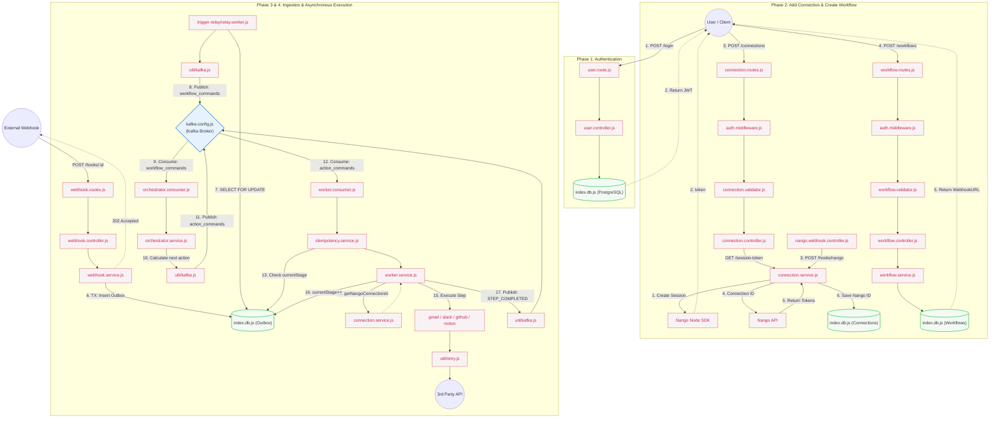
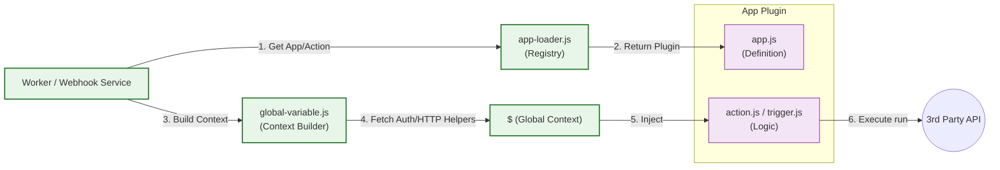
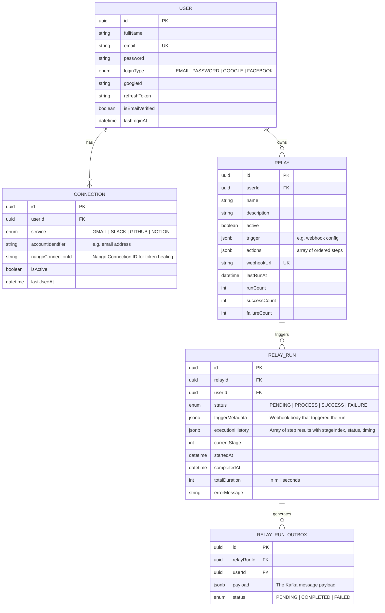
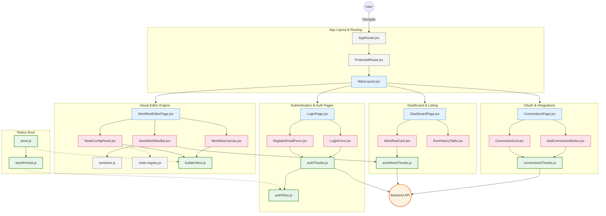

---

## Operational Safeguards & Architectural Patterns

### 1. Centralized Configuration Management (Zod)
RelayPoint enforces a strict configuration-as-code approach using **Zod** in `env.config.js`. This guarantees that the system is always in a valid state before initialization.
- **Fail-Fast**: Missing or malformed environment variables (e.g., incorrect URL formats) cause immediate process termination during the startup phase.
- **Transformation**: Raw string values from `.env` are automatically cast to their appropriate runtime types (Boolean, Number, Array).

### 2. Workflow Loop Protection (Anti-Recursion)
To maintain platform stability, a sophisticated loop-detection mechanism is implemented in `webhook.service.js`. It prevents infinite cascading executions caused by circular workflow dependencies.
- **Rate-Limiting**: Tracks workflow execution frequency per ID using a sliding window.
- **Thresholds**: Defaults to 10 executions per 60 seconds (configurable via `WORKFLOW_LOOP_THRESHOLD`).
- **Failure Mode**: Exceeding the threshold results in an explicit `ApiError`, which is logged and reported to the orchestrator.

### 3. Outbox Relay Pattern
The platform ensures **at-least-once delivery** of workflow triggers to Kafka by utilizing the Outbox Relay pattern.
- **Transactionality**: Webhook payloads are saved to the `RelayRunOutbox` table in the same database transaction as the initial run state.
- **Reliable Publishing**: A dedicated `relay.worker.js` process polls for `PENDING` outbox entries and publishes them to Kafka, marking them `COMPLETED` only after successful delivery.

### 4. Modular Service Architecture (`server/src/apps`)
RelayPoint uses a standardized plugin system to handle diverse third-party integrations. Each "App" defines its actions and triggers, which are executed within a sandboxed context.

#### Service Execution Flow

---

---

## Detailed Diagram

```mermaid
flowchart TD
    classDef page fill:#e3f2fd,stroke:#1976d2,stroke-width:1px;
    classDef feature fill:#fce4ec,stroke:#c2185b,stroke-width:1px;
    classDef shared fill:#f5f5f5,stroke:#616161,stroke-width:1px;
    classDef model fill:#fff9c4,stroke:#fbc02d,stroke-width:1px;
    classDef redux fill:#e8f5e9,stroke:#388e3c,stroke-width:2px;
    classDef api fill:#fff3e0,stroke:#e65100,stroke-width:2px;

    User((User))

    subgraph AppShell [App Shell, Layout & Setup]
        Boot[main.jsx]:::shared
        AppSetup[App.jsx]:::shared
        RootProv[RootProvider.jsx]:::shared
        AppProv[AppProviders.jsx]:::shared
        ThemeProv[ThemeProvider.jsx]:::shared
        Router[AppRouter.jsx]:::shared
        GR[GuestRoute.jsx]:::shared
        PR[ProtectedRoute.jsx]:::shared
        ML[MainLayout.jsx]:::page
        Sidebar[AppSidebar.jsx]:::feature
        Header[AppHeader.jsx]:::feature
        Nav[NavItem.jsx]:::feature
        UM[UserMenu.jsx]:::feature
        Req[request.js]:::model
        Err[errorHandler.js]:::model
        Succ[successHandler.js]:::model
        Code[codeMessage.js]:::model
        NotFound[NotFoundPage.jsx]:::page
        Boot --> RootProv --> AppProv --> ThemeProv --> AppSetup --> Router
        Router --> GR & PR & NotFound
        PR --> ML
        ML --> Sidebar & Header
        Sidebar --> Nav & UM
    end

    User -->|Launch| Boot

    subgraph EntityModels [Shared Domain Models]
        UModel[user.types.js]:::model
        RModel[relay.types.js]:::model
        RRModel[relay-run.types.js]:::model
        CModel[connection.types.js]:::model
    end

    subgraph Auth [Authentication & Auth Pages]
        LoginPage[LoginPage.jsx]:::page
        RegEmailPage[RegisterEmailPage.jsx]:::page
        RegUserPage[RegisterUserPage.jsx]:::page
        VerifyPage[VerifyOTPPage.jsx]:::page
        ForgotPage[ForgotPasswordPage.jsx]:::page
        ResetPage[ResetPasswordPage.jsx]:::page

        LoginForm[LoginForm.jsx]:::feature
        RegEmailForm[RegisterEmailForm.jsx]:::feature
        RegUserForm[RegisterUserForm.jsx]:::feature
        OTPInp[OTPInput.jsx]:::feature
        VerifyForm[VerifyOTPForm.jsx]:::feature
        ForgotForm[ForgotPasswordForm.jsx]:::feature
        ResetForm[ResetPasswordForm.jsx]:::feature

        AuthMut[auth.mutations.js]:::api
        AuthSchema[auth.schemas.js]:::model

        AuthThunk[authThunks.js]:::redux
        AuthSlice[authSlice.js]:::redux
        AuthSvc[auth.service.js]:::api

        LoginPage --> LoginForm
        RegEmailPage --> RegEmailForm
        RegUserPage --> RegUserForm
        VerifyPage --> VerifyForm
        VerifyForm -.-> OTPInp
        ForgotPage --> ForgotForm
        ResetPage --> ResetForm

        LoginForm & RegEmailForm & RegUserForm & VerifyForm & ForgotForm & ResetForm --> AuthSchema
        LoginForm & RegEmailForm & RegUserForm & VerifyForm & ForgotForm & ResetForm --> AuthMut
        AuthMut --> AuthThunk --> AuthSlice
        AuthThunk --> AuthSvc
    end

    subgraph Settings [Profile & Settings]
        SetPage[SettingsPage.jsx]:::page
        ProfSec[ProfileSection.jsx]:::feature
        PassForm[ChangePasswordForm.jsx]:::feature
        SetMut[settings.mutations.js]:::api

        SetPage --> ProfSec & PassForm
        PassForm --> SetMut
        SetMut --> AuthThunk
    end

    subgraph Connections [OAuth & Integrations]
        ConnPage[ConnectionsPage.jsx]:::page
        AddConnBtn[AddConnectionButton.jsx]:::feature
        ConnGrid[ConnectionGrid.jsx]:::feature
        ConnCard[ConnectionCard.jsx]:::feature
        SvcIcon[ServiceIcon.jsx]:::feature
        DelConnDlg[DeleteConnectionDialog.jsx]:::feature

        ConnQry[connection.queries.js]:::api
        ConnMut[connection.mutations.js]:::api

        ConnThunk[connectionsThunks.js]:::redux
        ConnSlice[connectionsSlice.js]:::redux

        ConnPage --> AddConnBtn & ConnGrid
        ConnGrid --> ConnCard --> SvcIcon & DelConnDlg
        ConnGrid --> ConnQry
        AddConnBtn & DelConnDlg --> ConnMut
        ConnQry & ConnMut --> ConnThunk --> ConnSlice
    end

    subgraph Workflows [Dashboard & Listing]
        DashPage[DashboardPage.jsx]:::page
        WFListPage[WorkflowListPage.jsx]:::page
        StatOverview[StatsOverview.jsx]:::feature
        StatCard[StatCard.jsx]:::feature
        RunChart[RunChart.jsx]:::feature
        WFFilters[WorkflowFilters.jsx]:::feature
        WFGrid[WorkflowGrid.jsx]:::feature
        WFCard[WorkflowCard.jsx]:::feature
        RunHist[RunHistoryTable.jsx]:::feature
        RunBadge[RunStatusBadge.jsx]:::feature
        DelWFDlg[DeleteWorkflowDialog.jsx]:::feature

        WFFilterMod[workflow.filters.js]:::model
        WFQry[workflow.queries.js]:::api
        WFMut[workflow.mutations.js]:::api

        WFThunk[workflowsThunks.js]:::redux
        WFSlice[workflowsSlice.js]:::redux

        DashPage --> StatOverview & RunHist
        StatOverview --> StatCard & RunChart
        WFListPage --> WFFilters & WFGrid
        WFFilters --> WFFilterMod
        WFGrid --> WFCard
        WFCard --> DelWFDlg
        RunHist --> RunBadge
        
        WFGrid --> WFQry
        WFCard --> WFMut
        WFQry & WFMut --> WFThunk --> WFSlice
    end

    subgraph Builder [Visual Editor Engine]
        EditorPage[WorkflowEditorPage.jsx]:::page
        SaveBtn[SaveWorkflowBar.jsx]:::feature
        Palette[NodePalette.jsx]:::feature
        Canvas[WorkflowCanvas.jsx]:::feature
        Controls[CanvasControls.jsx]:::feature
        TNode[TriggerNode.jsx]:::feature
        ANode[ActionNode.jsx]:::feature
        ConfigPnl[NodeConfigPanel.jsx]:::feature
        TForm[TriggerConfigForm.jsx]:::feature
        AForm[ActionConfigForm.jsx]:::feature
        GM[GmailConfigFields.jsx]:::feature
        SL[SlackConfigFields.jsx]:::feature
        GH[GitHubConfigFields.jsx]:::feature
        NO[NotionConfigFields.jsx]:::feature

        BldMut[builder.mutations.js]:::api
        BldSchem[builder.schemas.js]:::model
        NodeReg[node-registry.js]:::model
        NodeTyps[node-types.js]:::model
        Serialize[serializer.js]:::model

        BuilderSlice[builderSlice.js]:::redux

        EditorPage --> SaveBtn & Palette & Canvas & ConfigPnl
        Canvas --> Controls & NodeTyps
        NodeTyps --> TNode & ANode
        ConfigPnl --> TForm & AForm
        AForm --> GM & SL & GH & NO
        
        Palette & AForm & TForm -.-> NodeReg
        TForm & AForm -.-> BldSchem
        SaveBtn --> BldMut -.-> Serialize
        Canvas & ConfigPnl --> BuilderSlice
        BldMut --> WFThunk
    end

    subgraph ExecMonitor [Execution Tracking]
        WFDetailPage[WorkflowDetailPage.jsx]:::page
        ExecLog[ExecutionLogger.jsx]:::feature
        ExecTime[ExecutionTimeline.jsx]:::feature
        Stage[StageCard.jsx]:::feature
        
        ExecQry[execution.queries.js]:::api
        ExecUtil[execution.utils.js]:::model

        WFDetailPage --> RunHist & ExecLog
        ExecLog --> ExecTime --> Stage
        ExecLog --> ExecQry
        Stage -.-> ExecUtil
        ExecQry --> WFThunk
    end

    ML --> Auth & Settings & Connections & Workflows & Builder & ExecMonitor

    subgraph StateManager [Redux Root]
        Store[store.js]:::redux
        Persist[storePersist.js]:::redux
        Store --> Persist
        Persist -.-> AuthSlice & ConnSlice & WFSlice & BuilderSlice
        Req -.-> Store
    end

    AuthSvc & ConnThunk & WFThunk --> BackendAPI((Backend API)):::api
```

---